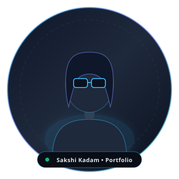

# Sakshi Kadam — Developer Portfolio Website

A modern, responsive, high-performance personal developer portfolio website for **Sakshi Kadam**, Python Full Stack Developer & MCA student exploring Data Science and AI.

---

## 📁 Project Structure

```
portfolio/
├── index.html                           # Main semantic HTML5 portfolio page
├── README.md                            # Documentation & customization guide
└── assets/
    ├── css/
    │   └── style.css                    # Responsive dark developer styles & variables
    ├── js/
    │   ├── portfolio-data.js            # Centralized project, skill, and credential data
    │   └── main.js                      # Navigation, modals, form validation, micro-interactions
    ├── images/
    │   ├── favicon.svg                  # Monogram developer favicon
    │   ├── profile-placeholder.svg      # Replaceable avatar placeholder
    │   ├── mudra-event-preview.svg      # Mudra Event UI preview graphic
    │   ├── food-ordering-preview.svg    # AI-Powered Food Ordering preview graphic
    │   └── mock-interview-preview.svg   # Smart Mock Interview preview graphic
    └── Sakshi_Kadam_Resume.pdf          # Replaceable downloadable resume PDF
```

---

## 🎨 How to Customize & Update Content

### 1. Adding Your Real Profile Photo
1. Place your photograph (e.g. `sakshi-kadam.jpg` or `profile.jpg`) into `assets/images/`.
2. Open `index.html` and locate line around `#hero-profile-image`:
   ```html
   
   ```
3. Change `src` to `assets/images/your-photo.jpg`. The circular glowing frame and badges will automatically adapt to your photograph.

### 2. Updating Mudra Event Live URL
- Open `index.html` and update the `href` attribute on `<a id="btn-live-mudra">`.
- Also update `liveUrl` inside `assets/js/portfolio-data.js`.

### 3. Replacing Your Resume PDF
- Drop your latest resume PDF into `assets/` and name it `Sakshi_Kadam_Resume.pdf` (or update the filename in `assets/js/portfolio-data.js` and `index.html`).

### 4. Connecting the Contact Form
- Currently, submitting the form prepares the message with complete client-side validation and provides an instant one-click button to open your email client.
- To connect a backend service like **Formspree**, simply add `action="https://formspree.io/f/YOUR_FORM_ID"` and `method="POST"` to `<form id="portfolio-contact-form">` in `index.html`.

---

## 🚀 Key Features Built-In
- **Strict Content Accuracy**: Built exactly to your specifications with zero fake statistics, zero exaggerated claims, and zero proficiency percentages.
- **Python Primary Visual Emphasis**: Highlighted with an illuminated badge in the skills grid.
- **Featured Projects**:
  - **Mudra Event** marked with a pulsing `LIVE REAL-WORLD PROJECT` badge, detailing the Railway production deployment and migration from PythonAnywhere.
  - **AI-Powered Food Ordering & Chatbot System** (FastAPI, Dialogflow, MySQL).
  - **Smart Mock Interview System** (Java, Spring Boot, Ollama LLM, MySQL).
- **Currently Exploring**: Dedicated section for Data Science, NumPy, Pandas, SQL, and Generative AI.
- **Job Simulations**: Deloitte Data Analytics Job Simulation clearly distinguished from academic degrees and formal certifications.
- **Interactive Modals**: Detailed architectural breakdowns for each project + on-screen resume viewer.
- **Accessibility & Performance**: Semantic HTML, ARIA dialogs, keyboard navigation, visible focus indicators, and `prefers-reduced-motion` compliance.
